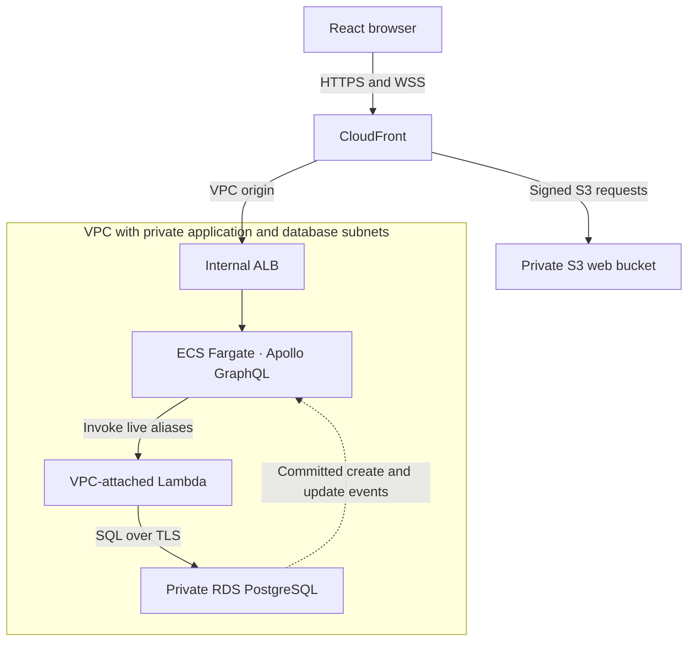

# Architecture

The deployed environment is `dev` in `us-east-1`. Terraform starts in [infrastructure/environments/dev](../infrastructure/environments/dev/main.tf). SAM manages the Lambda application stack.

## Client requests

The browser uses the same origin for static files and GraphQL. The standard CloudFront TLS certificate covers the CloudFront hostname. Hashed JavaScript and CSS files use long cache lifetimes. HTML and GraphQL are uncached. [AWS documents WebSocket support for CloudFront VPC origins](https://aws.amazon.com/about-aws/whats-new/2026/05/amazon-cloudfront-websockets-vpc-origins/).

Apollo invokes the `live` Lambda aliases for user CRUD and verifies the subscription trigger through the subscription readiness Lambda. PostgreSQL publishes a notification after each committed insert or update. Each Fargate task maintains a dedicated PostgreSQL listener and delivers events to its local WebSocket clients, regardless of which task handled the mutation. Queries after reconnect refresh the directory. Notifications are live and are not replayed.

The HTTP API Gateway VPC link from the original project remains available for HTTP clients. It reaches the same authenticated Apollo endpoint. Use the CloudFront URL for the browser and subscriptions.

## Deployment and operations

| Service | What happens there | Implementation |
|---|---|---|
| GitHub Actions and IAM | Validate changes and assume the scoped AWS release role through OIDC | [Workflow](../.github/workflows/ci-cd.yml) · [IAM](../infrastructure/environments/dev/iam.tf) |
| ECR, CloudFormation, ECS, and S3 | Push the Apollo image, deploy the SAM stack, roll ECS, and publish React after smoke tests | [Release script](../scripts/release.sh) |
| Secrets Manager | Supply the database credentials and shared demo token | [RDS module](../infrastructure/terraform/rds/main.tf) · [Frontend infrastructure](../infrastructure/environments/dev/frontend.tf) |
| CloudWatch and SNS | Collect service logs and metrics, evaluate alarms, and publish alarm notifications | [Monitoring](../infrastructure/environments/dev/monitoring.tf) |

## Cost and database choices

Dev uses a single PostgreSQL instance and one NAT gateway. RDS Proxy was skipped to avoid the additional cost. Lambda connects directly to RDS over TLS, and each Fargate task uses one direct PostgreSQL connection for notifications. The React build uses static hosting, so serving it requires no dedicated frontend compute.
