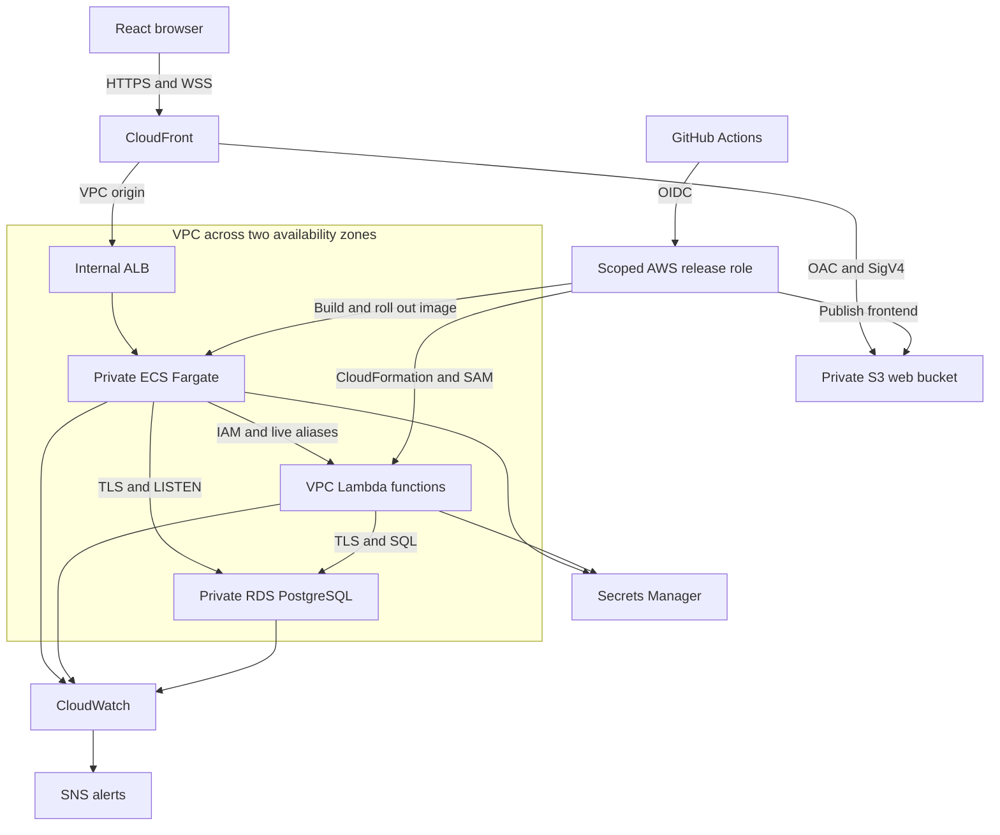

# Architecture

The browser uses the same origin for static files and GraphQL. The standard CloudFront TLS certificate covers the CloudFront hostname. Hashed JavaScript and CSS files use long cache lifetimes. HTML and GraphQL are uncached. [AWS documents WebSocket support for CloudFront VPC origins](https://aws.amazon.com/about-aws/whats-new/2026/05/amazon-cloudfront-websockets-vpc-origins/).

Apollo invokes the `live` Lambda aliases for user CRUD and verifies the subscription trigger through the subscription readiness Lambda. PostgreSQL publishes a notification after each committed insert or update. Each Fargate task maintains a dedicated PostgreSQL listener and delivers events to its local WebSocket clients, regardless of which task handled the mutation. Queries after reconnect refresh the directory. Notifications are live and are not replayed.

The HTTP API Gateway VPC link from the original project remains available for HTTP clients. It reaches the same authenticated Apollo endpoint. Use the CloudFront URL for the browser and subscriptions.
